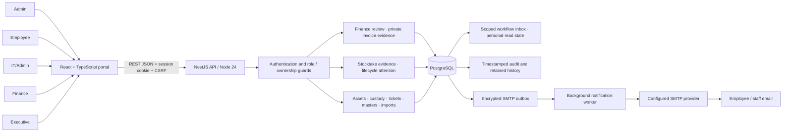
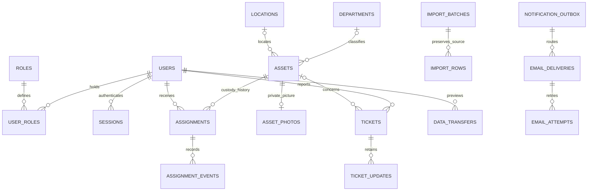
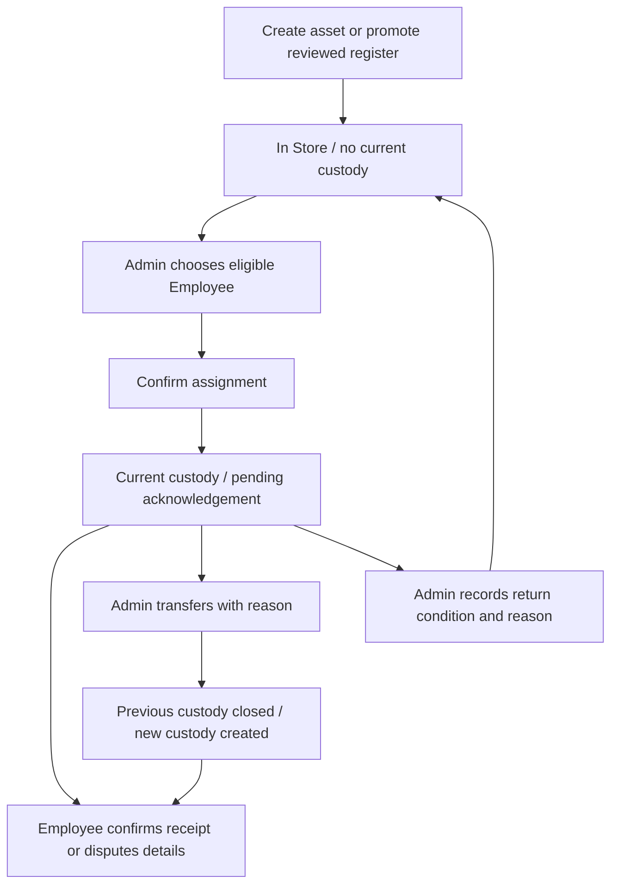
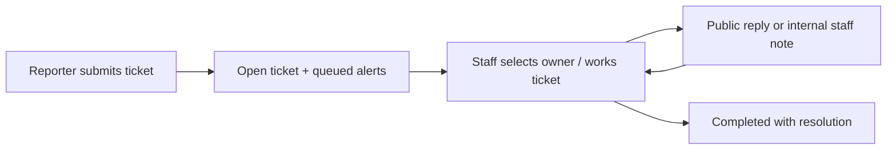

# IAC Asset Management Platform

System design and role-based user guide · 29 October 2026, 01:17 IST

This guide describes the implemented, locally tested single-organization release candidate, not a production-certified system. Production hosting, branding approval, retention and Finance policy remain owner configuration. Diagrams show logical relationships rather than every database column. Screen sketches illustrate navigation; they are not live screenshots.

## 1. System architecture



React renders role-specific navigation and uses cached queries with paginated lists. NestJS remains the authority for permissions, validation and record versions. PostgreSQL stores inventory, private photos, custody, ticket history and import provenance. Business writes, history and queued notifications commit together; the worker delivers asynchronously. A queued message is not proof of inbox delivery.

Local services: web `127.0.0.1:5173`, API `127.0.0.1:3000/api/v1`, and PostgreSQL on the private configured port. Use the local Mailpit sink for synthetic training. An approved real SMTP provider and sender remain separate operational setup. Automated tests use a separate database ending `_test` and isolated SMTP settings, never operational data or real SMTP credentials.

## 2. Logical data model



Key rules: Asset IDs and master codes are permanent. Only one current custody may exist for an asset. Employee ID and names are reference data, not account identity; approved email identifies recipients. Portal acceptance and receipt acknowledgement are separate evidence. Raw import fields remain unchanged; corrections are stored separately. Audit events connect actions to actors, request IDs and timestamps. Reference values control categories, statuses and other options; fixed workflow codes permit label changes without changing behavior.

## 3. Roles and access

| Action | Admin | Employee | IT/Admin role alone |
|---|---|---|---|
| Create/edit assets, upload photos | Yes | No | No |
| Assign, transfer, return assets | Yes | No | No |
| Read asset information | Catalog | Own current custody | Related-ticket technical scope |
| Acknowledge assigned equipment | If acting as assigned Employee | Own custody | If separately an assigned Employee |
| Create support tickets | Own reporter | Own reporter | Own reporter |
| Respond/manage ticket queue and complete tickets | Yes | Own public discussion only | Yes |
| Read internal ticket notes | Yes | No | Yes |
| Manage people, masters, routing, imports, audit | Yes | No | No |

| Additional action | Admin | Finance | Executive | Employee / IT-only |
|---|---|---|---|---|
| People & equipment directory | Yes | Yes, financial view | No | Employee own equipment only |
| Submit current asset for review | Yes | No | No | No |
| Retain private invoice PDF/XLSX | Yes | Yes | No | No |
| Independent Finance approve/return | Only with separate Finance role and not own submission | Yes | No | No |
| Aggregate Executive overview | Yes | Yes | Yes | No |
| Stocktake snapshots/observations/close | Yes | No | No | No |
| Lifecycle attention/recovery queue | Yes | No | No | No |
| Delivery health | Yes | No | No | No |
| Workflow inbox | Own permitted notices | Own permitted notices | Own permitted notices | Own permitted notices |

Roles can coexist on one account. Staff MFA is required. Employee responses exclude private financial/source fields and internal notes. UI visibility supports usability; server checks enforce access.

## 4. Sign in and first access

1. Obtain an approved invitation or ask Admin to approve your email before registration.
2. Use the invitation link to set up access, or complete approved registration and email verification.
3. Sign in with your own credentials. Staff complete authenticator enrollment/verification when prompted and keep recovery codes privately.
4. Read and accept the current portal notice. This authorizes portal access; it does not acknowledge any equipment.
5. Open your dashboard. Never share passwords, authenticator secrets or recovery codes in tickets or spreadsheets.

Expired invitation: ask Admin to use **People & access → Staff accounts → Resend invitation** on the invited account. A new invitation replaces earlier links. If an authenticator challenge expires, restart sign-in and enter a fresh current code; do not disable MFA to finish onboarding.

## 5. Admin daily workflow

### Set up departments and other masters

Open **Master Control**, select **Departments**, **Locations** or a reference group, then add an entry with a stable code, display name and reason. Save explicitly. Editing requires the current version and a change reason. Deactivate retired editable choices to preserve history. The default list shows active entries; choose inactive availability to find retired entries. Workflow groups allow display-label changes only.

### Onboard an employee

Open **People & access**, approve or invite the correct email, then wait for activation, email verification and portal acceptance. Assignment requires an active account with the Employee role. A staff account without that role is not an eligible custody recipient. Administrative role changes are privileged actions and may revoke existing sessions.

### Create an asset and add its photo

1. Open **Asset catalog → Create asset**.
2. Enter identity, category/type, ownership, condition, department and location. Use **In Store** for equipment ready for its first assignment.
3. Enter known financial metadata only; leave unknown values blank. Save to obtain the permanent generated Asset ID.
4. Open the saved asset's **Asset picture** panel. Choose JPEG/PNG up to 10 MiB, inspect the preview, enter a photo reason and choose **Save photo**.

Selecting a picture does not upload it. The server converts accepted photos, removes metadata and stores them privately. A labelled generic illustration appears until an actual laptop photo is saved.

### Assign, transfer and return



Open **Asset catalog → Assign asset**, choose equipment from the In Store chooser, select the employee, add an optional handover note and choose **Confirm assignment**. Catalog rows also offer the relevant action. If the recipient is not on the loaded page, load more employees. If none qualify, check account state, Employee role, email verification and portal acceptance in People & access.

Use **Transfer custody** for an already assigned asset. Choose a different recipient and enter the required reason. For return, use the asset's return controls and record condition, reason and any destination location. Custody changes queue normal notifications and retain history. A stale-version error means another change occurred: refresh, review the new state and deliberately retry. Do not repeatedly submit a stale handover.

### People-first equipment

Open **People & equipment**, search by name, email or employee reference, and open a person. Each laptop, monitor, mouse or keyboard keeps a separate permanent asset ID and custody history. Admin can assign another item and use each item's existing transfer/return controls. Finance sees approved-cost/review state and its financial-review link, not custody-write permission. An Employee uses **My equipment** for their own current items. The current directory is not an equipment bundle or atomic bulk handover.

### Invoice evidence and Finance review

Open **Finance review** and filter state, department, asset type or asset ID/description. Admin submits the current asset version with a reason. A different Finance reviewer opens the record and inspects cost, purchase date, invoice number and supplier. A return requires a reason; approval requires the financial fields and review reason. Editing the asset after submission requires resubmission before review. A remarks-only asset edit does not silently overwrite Finance-controlled values. After a later amendment, the last approved snapshot remains distinct from pending values.

In the invoice panel, choose a text PDF or plain XLSX up to4MiB. The original is retained privately with a SHA-256 hash. Upload does not change asset values or approve anything. Select individual suggested fields, acknowledge the review, then apply them to the form. Inspect the retained original and check quantity/tax/allocation: a grand total is not a per-asset cost. Independent approval is a separate action. Missing/conflicting values, scanned PDFs without text, foreign currency and ambiguous dates need manual review. No OCR, conversion or automatic allocation is claimed. Approval history retains the chosen evidence ID/hash and download link.

### Executive overview

Admin, Finance and Executive can read approved acquisition cost, approved/pending/unsubmitted coverage and operational counts. This is not net book value or depreciation. Department summary is bounded, not a full ledger export. Twelve Monday-start Asia/Kolkata weeks count recorded approval events (including amendments), tickets created and tickets completed. Current week is partial. These are not spending, historical backlog or SLA trends.

### Physical stocktake

Open **Physical stocktake**, give a count a meaningful name and choose **Create frozen stocktake**. Leave department/location blank for the whole organization, or select either scope. Selecting both uses the intersection. All asset statuses in that scope are included. Nothing has been declared physically seen yet. Open the count, enter the asset ID from its label, choose Seen / Not found / Mismatch, explain the observation and choose **Save observation only**. Unobserved is different from explicitly Not found; extra registered assets remain outside the frozen expectation. Corrections append evidence rather than erase it. Compare frozen/current/observed versions, review history and close with a reason. Closing stops new observations but does not reconcile inventory, custody, loss/disposal or Finance values. Unknown items need separate registration and discrepancies need separately authorized corrections.

### Lifecycle attention

Open **Lifecycle attention** and select due30/due90, expired or missing warranty/AMC dates. Dates use Asia/Kolkata, include endpoints and are recorded coverage, not vendor confirmation. AMC applies only when explicitly enabled. Recovery planning includes outstanding custody even for disabled or role-changed accounts. It is not a confirmed-leaver list. Open the person, recover the item physically and use the existing per-item reason/version return flow. Viewing this page sends no reminders, buys no renewal and disables no account.

## 6. Employee workflow

Open **Your assets**, select the equipment and review the permanent ID, description, serial number, condition and saved picture. Asset details and photos are read-only. Confirm receipt when accurate or report a discrepancy with a clear reason. Ask Admin to correct the inventory record; acknowledgement never edits the asset itself.

For support, open **Support desk → New ticket**, enter subject, category, priority and details, and optionally link your currently assigned asset. Include symptoms and troubleshooting already tried. Submit, then follow the ticket's public discussion. Previous ticket history remains available to its reporter after equipment is returned. Employees cannot see internal staff notes or complete tickets through staff controls.

## 7. IT/Admin ticket workflow



Open **Support desk**, filter the queue, inspect the request and related technical asset details, select an owner where appropriate and update progress. Choose visibility carefully: public replies are visible to the reporter; internal notes are staff-only. When resolved, record a meaningful resolution and mark **Completed**. Completing a ticket does not return or transfer equipment. Reopening completed tickets is outside the MVP.

## 8. Import, export and register review

| Task | Steps | Save boundary |
|---|---|---|
| Download a report | Apply filters → Export Excel/CSV | Read-only; all matching pages within scope |
| Load a form draft | Exact form template → one-row file → inspect → Load into form | Normal Save/Submit remains necessary |
| Bulk changes | Module template → file + reason → Validate import → inspect → confirm → Apply validated import | Entire valid batch applied atomically |
| Original register | Choose 42/44 layout → stage → review controls/corrections → reconcile → explicitly promote | Staging alone creates no inventory |

Excel/CSV files: one plain-value worksheet, up to 2 MiB, shared reader maximum 500 rows/100 columns. Bulk batches: maximum 50 rows and 60,000-byte JSON request. Exports: maximum 5,000 rows with an error instead of silent truncation. Bulk previews expire after 30 minutes until committed and belong to their creating user; Apply rechecks permissions and versions. Preview may reserve sequence numbers, so gaps in generated IDs are expected.

Use import templates rather than assuming report exports accept identical columns. Blank optional bulk cells generally omit changes; notification recipient lists explicitly allow blank to clear. Register correction rows replace the complete correction set for each supplied row; empty supplied fields reset prior overrides, while absent rows retain stored corrections. Typed correction cells use `json:<JSON value>`. Loading review files clears approvals and requires explicit review again.

Preserve original workbook/export fingerprints and raw source. Reconcile exact Asset IDs, known cost totals and missing-cost counts. Missing identity or ambiguous fields remain quarantined; names and Employee IDs do not authorize custody. Existing assets are not overwritten by promotion. Detailed fields and examples: [Transfer guide](DATA_TRANSFERS.md) and [REST API](API.md).

## 9. Screen design sketches

These sketches represent existing information hierarchy; they are not additional proposed features.

```text
ADMIN / ASSET CATALOG
┌──────────────────┬─────────────────────────────────────────────────┐
│ Overview         │ Asset catalog      [Assign asset] [Create asset]│
│ Asset catalog    │ Search [________________] Status [ ] Dept [ ]    │
│ Support desk     │ [Export Excel] [Export CSV] [Bulk import ▸]     │
│ Master Control   │ ID / Description  Status     Verification Action│
│ People & access  │ IAC-… / Laptop    In Store   No custody   Assign│
│ Import review    │ IAC-… / Laptop    Assigned   Pending      Transfer│
│ Audit / Routing  │                                      View →     │
└──────────────────┴─────────────────────────────────────────────────┘

ADMIN / ASSIGNMENT
┌────────────────────────────────────────────────────────────────────┐
│ ← Asset details                 Assign an asset                   │
│ Selected asset: IAC-… · Laptop         Status: In Store             │
│ Approved employee [Choose eligible employee                    ▾] │
│ Handover note     [____________________________________________]  │
│ New custody takes effect when confirmed; receipt is separate.     │
│ [Confirm assignment] [Cancel]                                    │
└────────────────────────────────────────────────────────────────────┘

EMPLOYEE / ASSET DETAIL
┌────────────────────────────────────────────────────────────────────┐
│ Your equipment · IAC-…                   Read-only details         │
│ [Private saved laptop picture]  Serial / model / condition        │
│ Receipt verification: [Confirm / report discrepancy workflow]     │
│ Need assistance? [Raise a ticket]                                │
└────────────────────────────────────────────────────────────────────┘

STAFF / TICKET DETAIL
┌────────────────────────────────────────────────────────────────────┐
│ Ticket #…  Subject               Status / priority / owner        │
│ Reporter description + related technical asset                   │
│ Timestamped conversation and permitted notes                     │
│ Reply [___________________] Visibility [Public / Internal]        │
│ Resolution [____________________________] [Mark Completed]       │
└────────────────────────────────────────────────────────────────────┘
```

Keep permanent IDs prominent, labels explicit and actions grouped by workflow. Use status text alongside colour. Tables scroll within their containers on small screens. Confirming custody, saving a photo, applying an import and promoting a register remain distinct deliberate actions.

## 9a. QR labels, scanner and workflow notifications

Admin opens label printing from the asset/catalog, chooses the supported sheet layout and deliberately records a print. Labels encode the application's asset-scan URL. Scan while signed in, or sign in and complete required MFA/portal acceptance before continuing. The asset/technical information and next actions depend on current role/custody/ticket scope. Scanning does not assign or approve an item. Use the asset page's permitted actions to raise a ticket or review details. Automated camera evidence uses generated QR pixels through a simulated video stream; printed labels and real phone-camera conditions remain unverified.

**Notifications** combines team announcements with account-specific workflow updates. Opening a workflow and marking it read are separate actions. Personal read state persists; another person's read receipt is not exposed. Assignment/import verification, receipt acknowledgements, public ticket updates/owner/status and Finance review events are created transactionally with the workflow. Current account/role/entity access is rechecked, and internal ticket-note bodies are never copied into these notices. The interface refreshes on focus and at a one-minute interval, not instant push. In-app read is not proof of email delivery or task completion.

Admin's **Email delivery health** shows pending/leased/SMTP accepted/dead states and safe attempt codes without message bodies, tokens or encrypted payloads. SMTP acceptance is not inbox delivery. In this local training environment, Mailpit is the test sink, not Gmail. Ticket/Finance queued mail is bound to the original account and rechecks current verified address/access before SMTP; already accepted mail cannot be recalled.

## 10. Security and operational design

Opaque revocable HttpOnly cookie sessions, CSRF protection, exact-origin checks, staff MFA and server-side role/ownership guards protect writes and private records. Passwords are hashed; sensitive authentication/mail envelopes are encrypted. Version headers prevent lost updates, while idempotency keys protect supported replayable commands. SQL transactions coordinate custody, audit and outbox writes. History and permanent identifiers are protected by database constraints/triggers. Restricted production runtime grants must be applied after migrations.

Production needs an approved domain/TLS, reachable invitation origin, SMTP sender/groups, private secret management, backup/PITR and restore drills including photos, retention, monitoring and capacity validation. Do not publish private `.env` files or source employee workbooks. Local startup commands and checks are in [README](../README.md); production gates are in [PRODUCTION](PRODUCTION.md).

## 11. Troubleshooting and training checklist

| Symptom | Check / action |
|---|---|
| App cannot open | Start Docker, PostgreSQL and API/web; verify health; retain database volume |
| Empty assignment chooser | Create equipment or explicitly promote reviewed rows; asset must be In Store without custody |
| Recipient missing | Active + Employee role + verified email + accepted portal; load remaining pages |
| Saved option disappeared | Check inactive availability; retired choices remain in history |
| Invitation queued but absent | Admin checks routing/worker/provider; resend only invited accounts; inspect latest link |
| Version conflict | Refresh, inspect current state and retry deliberately |
| Import rejected | Use exact template, plain values, correct layout and size limits; correct preview errors |
| Employee needs an asset correction | Report discrepancy or ticket; Admin edits the catalog |

Training exercise with synthetic data: Admin creates a department and asset, adds a photo and assigns it to a verified Employee. Employee reviews details, acknowledges receipt and raises a ticket. IT staff responds and completes it with a resolution. Admin verifies audit history and exports a permitted report. Use isolated test data and an isolated SMTP test configuration for training; do not send test invitations to real people.

Documentation basis: implemented README, REST API, transfer contracts, review and verification records. No live employee records or credentials are included. This guide was reconciled against the current implementation and127isolated integration cases. The wider verification record distinguishes earlier browser/unit checks and unverified production paths.
